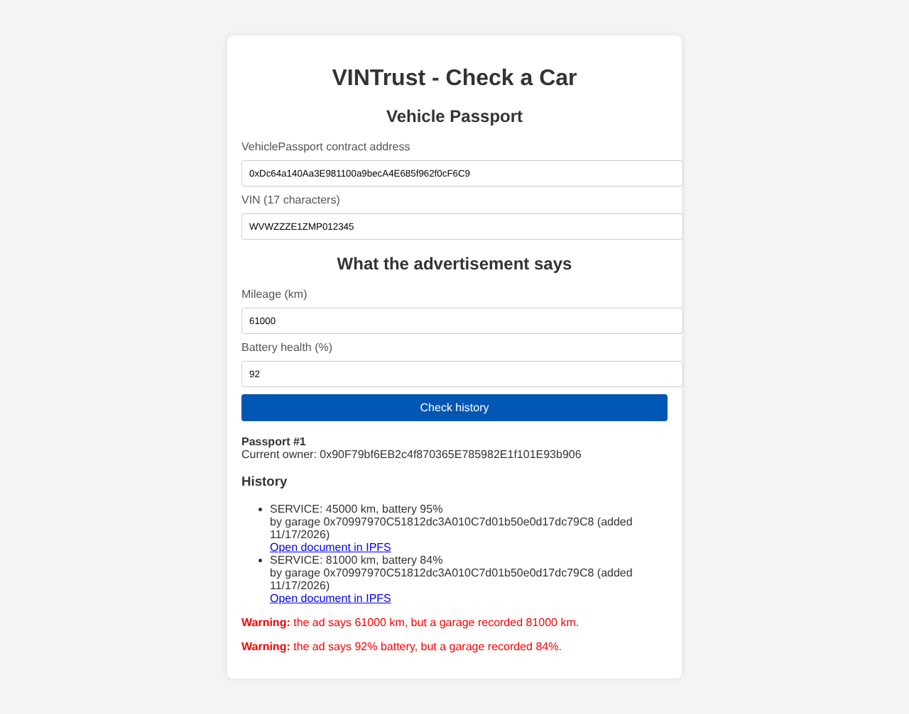

# VINTrust Prototype: Blockchain Vehicle Passport

This prototype for our HSLU group project builds the core of the VINTrust story from our canvas:

> Marco sells his used EV. The ad says **61,000 km and 92 % battery**. Milo, the buyer, enters the VIN
> and VINTrust shows that a verified garage recorded **81,000 km and 84 %** in 2023.

**New to the code? Read [docs/ARCHITECTURE.md](docs/ARCHITECTURE.md) first.** It explains the architecture and every part of the code step by step.

The prototype covers the three required building blocks:

| Requirement | What we use | Where |
|---|---|---|
| **SSI** | The class credential issuer, verifier and DID registry. The garage gets an `AuthorizedGarage` credential. Only after it has been verified does the association approve the garage on-chain. | `ssi/` (class code) |
| **Smart contract** | `VehiclePassport.sol`: one NFT per car (based on the class `MyNFT.sol`) plus a list of service records. | `hardhat/hardhat-dev/contracts/` |
| **IPFS (off-chain storage)** | The full service report goes to IPFS. Only the CID, the mileage and the battery health go on-chain. | class IPFS node, `ipfs/` |
| **dApp (optional)** | A read-only buyer page: enter a VIN and see the history and the warnings | `web-ui/vintrust.html` |



---

## What we added to the class environment

Everything else is the unchanged class code (first commit in this repo), so `git diff` against the
first commit shows exactly what is ours.

| File | New/changed | What it does |
|---|---|---|
| `hardhat/hardhat-dev/contracts/VehiclePassport.sol` | new | The smart contract (about 60 lines of logic) |
| `hardhat/hardhat-dev/test/VehiclePassport.js` | new | 8 automated tests |
| `hardhat/hardhat-dev/scripts/demo_vintrust.js` | new | Plays the whole Marco and Milo story (SSI, IPFS and the contract) |
| `hardhat/hardhat-dev/scripts/deploy_vehicle_passport.js` | new | Deploys only the VehiclePassport contract |
| `hardhat/hardhat-dev/scripts/deploy_all.js` | changed | Also deploys `VehiclePassport` (last, so the class addresses stay the same) and saves its address to `deployments.json` |
| `hardhat/hardhat-dev/package.json` | changed | New commands `npm run demo` and `npm run deploy_vehicle_passport` |
| `ssi/did-registry/index.js`, `server.js` | changed | DIDRegistry address set to `0xCf7E…0Fc9` (the address from the class PDF, section 2.2.1) |
| `ssi/credential-issuer/keys/.gitkeep` | new | Empty folder the issuer `Dockerfile` needs (`COPY keys …`) |
| `web-ui/vintrust.html`, `web-ui/js/vintrust.js` | new | Buyer page |
| `web-ui/index.html` | changed | Link to the buyer page |

### The contract in one minute

```
VehiclePassport  (ERC721 NFT + Ownable, from OpenZeppelin, like MyNFT)
│
├─ mintPassport(carOwner, vinHash)       only the association: one passport per VIN
├─ setGarageApproval(garage, true/false) only the association: after checking the SSI credential
├─ addRecord(tokenId, mileage, batteryHealth, recordType, ipfsCid)
│                                        only approved garages; mileage can never go down
├─ getRecords(tokenId)                   anyone: read the full history
└─ transferFrom(...)                     standard ERC721: selling the car moves the passport
```

Roles are Hardhat's built-in test accounts:

| Account | Role | Address |
|---|---|---|
| 0 | VINTrust association (deploys the contract, owner) | `0xf39F…2266` |
| 1 | Garage Muster AG | `0x7099…79C8` |
| 2 | Marco (seller) | `0x3C44…93BC` |
| 3 | Milo (buyer) | `0x90F7…b906` |

### Deliberately left out (design only, described in the canvas)

The following are left out of the code: escrow with a CHF stablecoin, the garage deposit and slashing, the membership soulbound token,
the reputation score, document encryption and owner-controlled access, and the registration authority oracle.
The VIN is stored as a plain `keccak256` hash. The canvas describes a *keyed* hash instead.

---

## Step-by-step guide: running it

Everything runs in Docker, so you only need **Docker Desktop** and **Git**. For the web page you also
need Python or the VS Code "Live Server" extension. The commands work the same in PowerShell, macOS
and Linux.

### 0. Get the code

```bash
git clone https://github.com/pHaoq/BlocchainTest.git
cd BlocchainTest
```

Start **Docker Desktop** and wait until it says "Engine running".

### 1. Create the Docker network (only once)

```bash
docker network create --driver bridge hardhat-network
```

If it says the network already exists, that's fine.

### 2. Start the blockchain and deploy the contracts

```bash
cd hardhat
docker compose build
docker compose up -d
docker compose logs -f hardhat-dev
```

Wait until the log shows the deployed addresses and the tests:

```
DIDRegisstry deployed to: 0xCf7Ed3AccA5a467e9e704C703E8D87F634fB0Fc9
VehiclePassport deployed to: 0xDc64a140Aa3E981100a9becA4E685f962f0cF6C9
...
  VehiclePassport
    ✔ mints one passport per VIN to the car owner
    ...
  14 passing
```

Press `Ctrl+C` to stop following the log. The blockchain keeps running.

### 3. Start the SSI services (issuer, verifier, DID registry)

```bash
cd ../ssi
docker compose build
docker compose up -d
```

### 4. Start IPFS

```bash
cd ../ipfs
docker compose pull ipfs
docker compose up -d
```

### 5. Run the demo (the Marco and Milo story)

```bash
cd ../hardhat
docker compose run --rm hardhat-dev npm run demo
```

Expected output (the CIDs may differ):

```
STEP 1: SSI - Garage Muster AG proves it is an authorized garage
  Credential issued to did:eth:0x70997970C51812dc3A010C7d01b50e0d17dc79C8
  Verifier says credential is valid: true
  Tampered credential is valid: false
  Association approved the garage in the smart contract

STEP 2: Vehicle Passport for Marco's car
  Passport #1 minted to Marco (0x3C44CdDdB6a900fa2b585dd299e03d12FA4293BC)

STEP 3: Garage adds service records (document -> IPFS, CID -> blockchain)
  2021-05-10: 45000 km, battery 95%  ->  IPFS CID Qm...
  2023-06-14: 81000 km, battery 84%  ->  IPFS CID Qm...
  Marco tried to add a fake record -> rejected (Not an approved garage)

STEP 4: Milo enters the VIN and checks the advertisement
  Advertisement: 61000 km, battery 92%
  Record 2021-05-10: 45000 km, battery 95%, SERVICE by Garage Muster AG (0x7099...)
  Record 2023-06-14: 81000 km, battery 84%, SERVICE by Garage Muster AG (0x7099...)
  WARNING: mileage in the ad (61000) is LOWER than the recorded 81000 km!
  WARNING: battery health in the ad (92%) is HIGHER than the recorded 84%!

STEP 5: Milo buys the car (after a lower counteroffer)
  Passport #1 owner is now: 0x90F79bf6EB2c4f870365E785982E1f101E93b906 (Milo: 0x90F7...)
  History still has 2 records
```

You can run the demo again. It skips the steps that are already done.

### 6. Open the buyer web page (optional)

```bash
cd ../web-ui
python -m http.server 5500
```

Open <http://localhost:5500/vintrust.html> and click **Check history**. The VIN, the contract address and
the ad values are already filled in. "Open document in IPFS" shows the service report that is stored in IPFS.

### 7. Run only the tests

```bash
cd hardhat
docker compose run --rm hardhat-dev npm run test
```

### 8. Stop everything

Run these from the repo folder:

```bash
cd ipfs       && docker compose down
cd ../ssi     && docker compose down
cd ../hardhat && docker compose down
```

Also press `Ctrl+C` in the window where the web page server (`python -m http.server`) runs.

* Optional full cleanup: `docker network rm hardhat-network`. You then need step 1 again next time.
* The blockchain is always gone after `down`. On the next start you get the same addresses again, and you just run the demo again.
* IPFS files stay in a Docker volume unless you add `-v` to the `down` command.

---

## Troubleshooting

* **I restarted Docker or my laptop and now nothing works.** Hardhat does not keep the blockchain
  when it stops (see the class PDF, section 1.2). Reset everything in this order:
  ```bash
  cd hardhat && docker compose down && docker compose up -d     # new chain, same addresses again
  cd ../ssi  && docker compose restart did-registry
  cd ../hardhat && docker compose run --rm hardhat-dev npm run demo
  ```
* **The contract addresses are different from the ones above.** This happens when contracts were deployed
  more than once on the same running chain. The demo reads the new address automatically from
  `hardhat/hardhat-dev/deployments.json`, but you have to update:
  the DIDRegistry address in line 1 of `ssi/did-registry/index.js` and `server.js` (then
  `docker compose build did-registry && docker compose up -d` in `ssi/`), and the contract address field on the web page.
  The easiest fix is the full reset above.
* **STEP 1 fails with `fetch failed`.** The SSI or IPFS containers are not running. Check with `docker ps`.
  You should see `hardhat-node`, `credential-issuer`, `credential-verifier`, `did-registry` and `ipfs_node`.
* **The web page shows "Error: … could not detect network".** The Hardhat node is not running on port 8545.

## Files for the canvas (P6)

* **6.1 Smart contracts:** `VehiclePassport` (above). Escrow, deposit and membership token are described as future work.
* **6.2 Gas:** these values were measured on the local Hardhat node (`receipt.gasUsed`, solc 0.8.20, optimizer off).
  Multiply them by your gas price assumption to get CHF.

  | Action | Gas |
  |---|---|
  | Deploy `VehiclePassport` (once) | 2,951,184 |
  | `mintPassport` (once per car) | 104,320 |
  | `setGarageApproval` (once per garage) | 48,375 |
  | `addRecord`, first record | 234,404 |
  | `addRecord`, later records | 219,935 |
  | `transferFrom` (sale) | 55,616 |
  | `getRecords` (read) | 0 (free, no transaction) |
* **6.3 Detailed explanation:** walk through `VehiclePassport.sol`. Each part of the contract is commented.
