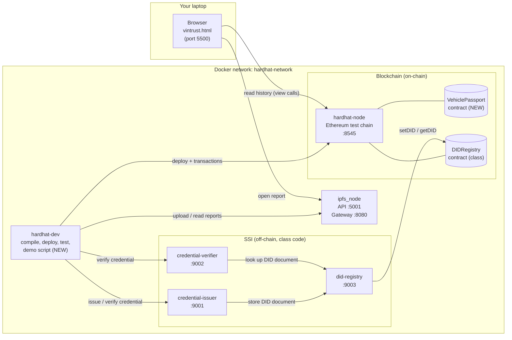
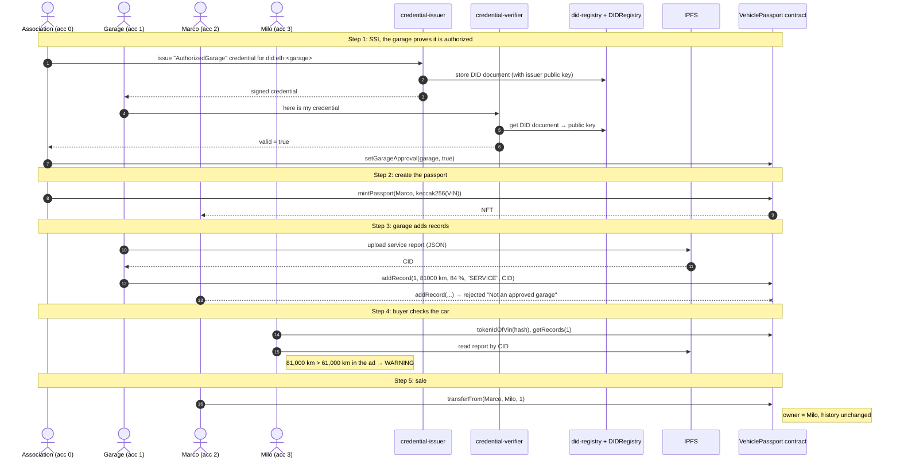

# VINTrust Prototype: Architecture and Code Explained

This document explains how the prototype works, so that every group member can explain it in the presentation.
It assumes you know the class examples (Counter, MyToken, MyNFT, SSI, IPFS), but nothing more.

How to *run* it is described in the [README](../README.md). This document explains *what* runs and *why*.

**Contents**

1. [The idea in one paragraph](#1-the-idea-in-one-paragraph)
2. [Architecture: the building blocks](#2-architecture-the-building-blocks)
3. [What is stored where (on-chain vs off-chain)](#3-what-is-stored-where-on-chain-vs-off-chain)
4. [Who is who: roles and accounts](#4-who-is-who-roles-and-accounts)
5. [The full flow, step by step](#5-the-full-flow-step-by-step)
6. [Code walkthrough: the smart contract](#6-code-walkthrough-the-smart-contract-vehiclepassportsol)
7. [Code walkthrough: SSI (class code we reuse)](#7-code-walkthrough-ssi-class-code-we-reuse)
8. [Code walkthrough: IPFS](#8-code-walkthrough-ipfs)
9. [Code walkthrough: the demo script](#9-code-walkthrough-the-demo-script-demo_vintrustjs)
10. [Code walkthrough: tests, deployment, buyer page](#10-code-walkthrough-tests-deployment-buyer-page)
11. [Design decisions and simplifications](#11-design-decisions-and-simplifications)
12. [Prototype vs canvas: what is built, what is design only](#12-prototype-vs-canvas-what-is-built-what-is-design-only)
13. [Questions you should be able to answer](#13-questions-you-should-be-able-to-answer)
14. [Glossary](#14-glossary)

---

## 1. The idea in one paragraph

Every car gets **one NFT, the "Vehicle Passport"**. Only **verified garages** can add entries
(mileage, battery health, a link to the full report) to this passport. Entries can never be changed or deleted, and
the mileage can never go down. A garage counts as verified once it shows an **SSI credential**, which the association
checks before it allows the garage to write. The full service report (a document) is too big and too private
for the blockchain, so it is stored in **IPFS**, and only its fingerprint (the CID) goes on-chain. A **buyer** can
enter a VIN and see the full, tamper-evident history. When the car is sold, the NFT moves to the new owner and
the history stays with the car.

---

## 2. Architecture: the building blocks

All parts run as Docker containers in one Docker network called `hardhat-network`. The containers find
each other by name (for example `http://credential-issuer:9001`). From your laptop you reach them through
`localhost` and the port.



| Container | What it is | Port | From class or new? |
|---|---|---|---|
| `hardhat-node` | A local Ethereum blockchain with 20 test accounts, each holding 10,000 ETH | 8545 | class |
| `hardhat-dev` | Compiles the contracts, deploys them, runs the tests and our demo script. It stops when it's done. | – | class, plus our files |
| `credential-issuer` | Issues signed credentials (Verifiable Credentials) | 9001 | class |
| `credential-verifier` | Checks whether a credential's signature is valid | 9002 | class |
| `did-registry` | Stores DID documents, either in a JSON file or in the `DIDRegistry` smart contract | 9003 | class |
| `ipfs_node` | Local IPFS node for file storage | 5001 (API), 8080 (gateway) | class |
| web-ui | Plain HTML/JS pages, served by `python -m http.server` | 5500 | class, plus our page |

**Important:** the only new *service* is the smart contract. Everything else is the class infrastructure
used as it is. Our new code is a contract, a script, tests and one web page.

---

## 3. What is stored where (on-chain vs off-chain)

| Data | Where | Why there |
|---|---|---|
| Passport NFT (token id, current owner) | **On-chain** (`VehiclePassport`) | Must be unique, transferable and readable by everyone |
| `keccak256(VIN)` → token id | **On-chain** | Ensures only one passport per car. The plain VIN is not stored. |
| List of approved garages | **On-chain** | Everyone can see who is allowed to write |
| Each record: garage address, mileage, battery %, type, IPFS CID, timestamp | **On-chain** | These are the facts the buyer needs to trust, so they must be tamper-evident |
| Full service report (JSON document) | **Off-chain: IPFS** | Too big and too private for the chain. The CID on-chain proves the document wasn't changed. |
| DID documents (public key of the issuer) | **On-chain** (`DIDRegistry` contract, class) | The verifier must be able to find the public key |
| Credentials (the signed JSON) | **Off-chain**: held by the garage (in the demo: just a variable in the script; in the class web-ui: browser local storage) | The holder controls their own credential (that's the idea of SSI) |
| Issuer private keys | **Off-chain**, inside the issuer container | Must stay secret |

---

## 4. Who is who: roles and accounts

Hardhat creates 20 test accounts from the mnemonic `test test … junk`. We use the first four:

| Account | Role in the story | What it is allowed to do |
|---|---|---|
| `0` `0xf39F…2266` | **VINTrust association** | Deploys the contract and becomes its **owner**. Mints passports and approves or revokes garages. (It is also the account the class `did-registry` uses to write DIDs.) |
| `1` `0x7099…79C8` | **Garage Muster AG** | After approval: adds records |
| `2` `0x3C44…93BC` | **Marco** (seller) | Holds the passport and can transfer it |
| `3` `0x90F7…b906` | **Milo** (buyer) | Reads the history and receives the passport when he buys the car |

In the demo script these are simply `const [association, garage, marco, milo] = await ethers.getSigners();`.

---

## 5. The full flow, step by step

This is exactly what `npm run demo` does:



---

## 6. Code walkthrough: the smart contract (`VehiclePassport.sol`)

File: [`hardhat/hardhat-dev/contracts/VehiclePassport.sol`](../hardhat/hardhat-dev/contracts/VehiclePassport.sol)

### 6.1 Inheritance: the same as the class `MyNFT`

```solidity
import "@openzeppelin/contracts/token/ERC721/ERC721.sol";
import "@openzeppelin/contracts/access/Ownable.sol";

contract VehiclePassport is ERC721, Ownable {
```

* `ERC721` (from OpenZeppelin) gives us a complete NFT: `ownerOf`, `balanceOf`, `transferFrom`, `approve`,
  the `Transfer` events and so on. We don't write any of that ourselves.
* `Ownable` gives us an `owner()` and the `onlyOwner` modifier. The owner is whoever deploys the contract
  (the association). This is the same as in `MyNFT` and `MyToken`.

Compared with `MyNFT`, we **removed** `ERC721URIStorage`, because we don't need a metadata URL per token. Our "metadata"
is the list of records.

### 6.2 The data structure

```solidity
struct Record {
    address garage;        // who wrote the record
    uint256 mileage;       // km at the time of the record
    uint8 batteryHealth;   // EV battery state of health in %
    string recordType;     // e.g. "SERVICE", "ACCIDENT", "INSPECTION"
    string ipfsCid;        // IPFS content id of the document
    uint256 timestamp;     // block time when the record was added
}

uint256 private _nextTokenId = 1;                 // start at 1, so 0 means "no passport"
mapping(bytes32 => uint256) public tokenIdOfVin;  // hash of VIN => token id
mapping(address => bool) public approvedGarages;  // garages allowed to write
mapping(uint256 => Record[]) private _records;    // token id => history
```

* A `struct` is like a small class without methods, and it groups the fields of one record.
* A `mapping` is like a hash map or dictionary. Every possible key exists and returns `0`, `false` or empty by default.
  * `tokenIdOfVin`: given the VIN hash, which passport is it? `0` means "none", which is why token ids start at **1**.
  * `approvedGarages`: `true` if the garage may write.
  * `_records`: for each token id, an **array** of records (the history).
* `public` variables automatically get a getter function, so you can call `tokenIdOfVin(hash)` and
  `approvedGarages(address)` from JavaScript without writing a function for them.

### 6.3 Events

```solidity
event PassportMinted(uint256 indexed tokenId, bytes32 indexed vinHash, address owner);
event GarageApproved(address indexed garage, bool approved);
event RecordAdded(uint256 indexed tokenId, address indexed garage, uint256 mileage, string ipfsCid);
```

Events are written into the transaction log. They cost little gas and let apps (or auditors) follow
what happened without reading all the storage. `indexed` fields can be used to filter, for example "all records of token 1".

### 6.4 Constructor

```solidity
constructor() ERC721("VINTrust Vehicle Passport", "VPASS") Ownable(msg.sender) {}
```

This sets the NFT name and symbol, and makes the deployer (`msg.sender` = account 0) the owner.

### 6.5 `mintPassport`: create a passport (association only)

```solidity
function mintPassport(address carOwner, bytes32 vinHash) public onlyOwner returns (uint256) {
    require(tokenIdOfVin[vinHash] == 0, "Passport for this VIN already exists");
    uint256 tokenId = _nextTokenId++;
    tokenIdOfVin[vinHash] = tokenId;
    _safeMint(carOwner, tokenId);
    emit PassportMinted(tokenId, vinHash, carOwner);
    return tokenId;
}
```

1. `onlyOwner`: only the association can call this. Anyone else gets a revert.
2. `require(...)`: if a passport for this VIN already exists, stop and undo everything. This is the
   **"one car = one passport"** rule from the canvas (section 3.3).
3. Take the next id (`_nextTokenId++` returns the current value and then increments it).
4. Remember VIN hash → id.
5. `_safeMint` (from ERC721) creates the NFT and gives it to the car owner.
6. Emit an event.

Why `bytes32 vinHash` and not the VIN as text? The plain VIN would be readable by everyone on-chain.
The hash is computed outside (`keccak256(VIN)`) and works like a lookup key.

### 6.6 `setGarageApproval`: approve or revoke a garage (association only)

```solidity
function setGarageApproval(address garage, bool approved) public onlyOwner {
    approvedGarages[garage] = approved;
    emit GarageApproved(garage, approved);
}
```

This is the bridge between **SSI (off-chain)** and the **contract (on-chain)**. The association checks the garage's
credential with the verifier first. Only if it's valid does it call this function with `true`. To remove a garage
(for example after fraud), it calls the function with `false`.

### 6.7 `addRecord`: add a history entry (approved garages only)

```solidity
function addRecord(uint256 tokenId, uint256 mileage, uint8 batteryHealth,
                   string memory recordType, string memory ipfsCid) public {
    require(approvedGarages[msg.sender], "Not an approved garage");
    require(_ownerOf(tokenId) != address(0), "Passport does not exist");
    require(batteryHealth <= 100, "Battery health must be 0-100");

    Record[] storage history = _records[tokenId];
    if (history.length > 0) {
        // simple odometer-fraud check: mileage can never go down
        require(mileage >= history[history.length - 1].mileage, "Mileage lower than last record");
    }

    history.push(Record(msg.sender, mileage, batteryHealth, recordType, ipfsCid, block.timestamp));
    emit RecordAdded(tokenId, msg.sender, mileage, ipfsCid);
}
```

Line by line:

1. **Access check:** `msg.sender` is the address that signed the transaction. If it is not an approved garage, revert.
   This is why Marco can't write a fake record.
2. **Passport must exist:** `_ownerOf` (from ERC721) returns `address(0)` for tokens that were never minted.
3. **Sanity check** on the percentage.
4. `Record[] storage history`: `storage` means "a reference to the array saved on the blockchain", not a copy.
   Changes to `history` are saved.
5. **Odometer rule:** compare with the last record. If the new mileage is lower, revert. This catches
   the classic odometer manipulation from our pain points (canvas section 1.2).
6. `push` appends the new record. `msg.sender` is stored as the garage, so the garage can't pretend to be someone else.
   `block.timestamp` is the time of the block.
7. **No update or delete function exists.** Once written, a record can never be changed. Corrections would be
   a *new* record (canvas section 4.3).

### 6.8 `getRecords`: read the history (anyone, free)

```solidity
function getRecords(uint256 tokenId) public view returns (Record[] memory) {
    return _records[tokenId];
}
```

`view` means this function only reads. Calling it from JavaScript costs **no gas** and needs no wallet.
`memory` means a copy is returned.

### 6.9 Selling the car

There is no function of ours for this. The standard ERC721 `transferFrom(from, to, tokenId)` is inherited. Only the
current owner (or someone they approved) can call it. The records are stored by **token id**, not by owner, so the
history automatically stays with the car.

---

## 7. Code walkthrough: SSI (class code we reuse)

We did not change any of the SSI logic. Here is what happens inside it when the demo runs.

### 7.1 Keys: `ssi/key-generator/generate-keys.js`

This generates two RSA key pairs (`issuer1`, `issuer2`) when the containers are built. They are shared with the
issuer through a Docker volume. **In our story, `issuer1` is the VINTrust association.**

### 7.2 Issuing: `ssi/credential-issuer/issuer.js` (`POST /issue-credential`)

Our demo sends:

```json
{
  "issuer": "issuer1",
  "did": "did:eth:0x70997970C51812dc3A010C7d01b50e0d17dc79C8",
  "credential": { "type": "AuthorizedGarage", "name": "Garage Muster AG", "uid": "CHE-123.456.789" },
  "registry": "blockchain"
}
```

The issuer then does the following:

1. It loads the private and public key of `issuer1`.
2. It builds a **DID document** `{ id: did, publicKey: <issuer1 public key>, issuer: "issuer1", ... }` and sends it
   to the `did-registry`. Because `registry` is `"blockchain"`, the registry calls `DIDRegistry.setDID(garageAddress, json)`
   on the chain, so the DID document is stored **on-chain**.
3. It builds the credential `{ content, issuedTo, issuedAt, issuer, registry }`.
4. It computes `SHA-256(JSON of the credential)` and **signs** that hash with the issuer's private key (RSA).
5. It returns the credential with the `signature` added. The garage keeps this (the holder).

### 7.3 Verifying: `ssi/credential-verifier/verifier.js` (`POST /verify-credential`)

1. It reads `credential.issuedTo` (the garage's DID) and asks the `did-registry` for the DID document, which comes from
   the `DIDRegistry` contract.
2. It takes the `publicKey` from that document.
3. It removes the `signature` from the credential, computes `SHA-256(JSON)` again and checks the signature with the public key.
4. If **any** field was changed after issuing, the hash is different and the check fails. The demo shows this with the
   "Tampered credential is valid: false" line, where we changed the garage name.

### 7.4 How the demo connects SSI to the contract

```js
const valid = await verifyCredential(credential);
if (!valid || credential.content.type !== "AuthorizedGarage") {
  throw new Error("Garage credential not valid - garage is NOT approved");
}
await passport.connect(association).setGarageApproval(garage.address, true);
```

So the rule is **"no valid credential → no permission to write on-chain"**. The check happens off-chain
(it involves RSA keys and an HTTP service). The *result* is written on-chain.

> **Known limitation of the class SSI (good to mention honestly):** the verifier only checks that the signature
> matches the public key in the DID document. It does not check *which* issuer is trusted, and there is no
> revocation list. In a real VINTrust, the verifier would also check "was this issued by the association?" and "is it
> revoked?" (canvas sections 2.2 and 5).

---

## 8. Code walkthrough: IPFS

IPFS stores files by their **content**. The address of a file (the **CID**, for example `QmY4ag…`) is computed from
the file's bytes. If one byte changes, the CID changes. So storing the CID on-chain is like storing a
**fingerprint**: anyone can download the document and know it is exactly the one the garage recorded.

We use the IPFS HTTP API, the same way the class page `web-ui/js/ipfs.js` does:

```js
// upload: returns the CID
const formData = new FormData();
formData.append("file", new Blob([JSON.stringify(report)]), "service-2023-06-14.json");
const res = await fetch(`${IPFS_URL}/api/v0/add`, { method: "POST", body: formData });
const cid = (await res.json()).Hash;

// download by CID
const res2 = await fetch(`${IPFS_URL}/api/v0/cat?arg=${cid}`, { method: "POST" });
```

A report looks like this:

```json
{
  "vin": "WVWZZZE1ZMP012345",
  "garage": "Garage Muster AG",
  "date": "2023-06-14",
  "mileage": 81000,
  "batteryHealth": 84,
  "recordType": "SERVICE",
  "work": "Annual service, tyres, battery check"
}
```

In the browser you can open any report through the gateway: `http://127.0.0.1:8080/ipfs/<CID>`.

> **Simplification:** the reports are **not encrypted**. IPFS is public, so anyone with the CID can read them.
> The canvas (section 7.3) says documents are encrypted before upload and the owner controls the key. That part is design only.

---

## 9. Code walkthrough: the demo script (`demo_vintrust.js`)

File: [`hardhat/hardhat-dev/scripts/demo_vintrust.js`](../hardhat/hardhat-dev/scripts/demo_vintrust.js).
It is started with `npx hardhat run … --network localhost` (`npm run demo`). That way it gets the `ethers` object
and the 20 test accounts from Hardhat, just like the class deploy scripts.

Structure:

| Part | What it does |
|---|---|
| Config at the top | Service URLs (container names by default) and the VIN and ad values from the story |
| `issueCredential`, `verifyCredential` | Same HTTP calls as the class `ssi/test.js`, but with Node's built-in `fetch` instead of axios |
| `uploadToIpfs`, `readFromIpfs` | IPFS HTTP API (see section 8) |
| `main()` | Steps 1 to 5 from the sequence diagram |

Useful patterns to recognize:

* `ethers.getContractAt("VehiclePassport", address)` connects to the already deployed contract. The address comes
  from `deployments.json`, which `deploy_all.js` writes.
* `passport.connect(garage).addRecord(...)` sends the transaction **as the garage**. Without `.connect(...)`,
  ethers uses account 0.
* `await (await passport.someFunction(...)).wait()`: the first `await` sends the transaction, and `.wait()` waits until it is mined.
* `ethers.utils.keccak256(ethers.utils.toUtf8Bytes(VIN))` is the same hash the contract expects.
* The `try { … } catch` around Marco's `addRecord` expects a revert. That's how we show the access control works.
* The script can be **run repeatedly**. If the passport or the records already exist, it skips those steps.

---

## 10. Code walkthrough: tests, deployment, buyer page

### 10.1 Tests: `test/VehiclePassport.js` (8 tests)

These are written like the class tests (Mocha + Chai + ethers v5). Before each test, `beforeEach` deploys a **fresh** contract,
mints passport #1 to Marco and approves the garage. Each test then checks one rule:

| Test | Rule it proves |
|---|---|
| mints one passport per VIN | `ownerOf(1)` is Marco, and a second mint for the same VIN reverts |
| only the association can mint and approve | `onlyOwner` works |
| approved garage can add, anyone can read | the happy path, with all fields checked |
| rejects non-garages | Marco can't write |
| rejects after revocation | `setGarageApproval(garage, false)` works |
| rejects lower mileage | the odometer-fraud check |
| rejects non-existing passport | can't write to token 99 |
| history stays after sale | `transferFrom` → owner is Milo, records still there |

`.to.be.revertedWith("…")` checks that the transaction failed with exactly that `require` message.

### 10.2 Deployment: `scripts/deploy_all.js`

This is the class script with one addition at the end: it deploys `VehiclePassport` and writes its address to
`deployments.json`. It is deployed **last**, so the class contracts keep their known addresses.

On a fresh chain, addresses are **deterministic**. They depend only on the deployer's address and its transaction count:

| # | Contract | Address |
|---|---|---|
| 0 | Counter | `0x5FbDB2315678afecb367f032d93F642f64180aa3` |
| 1 | MyToken | `0xe7f1725E7734CE288F8367e1Bb143E90bb3F0512` |
| 2 | MyNFT | `0x9fE46736679d2D9a65F0992F2272dE9f3c7fa6e0` |
| 3 | DIDRegistry | `0xCf7Ed3AccA5a467e9e704C703E8D87F634fB0Fc9` (hard-coded in `ssi/did-registry`) |
| 4 | **VehiclePassport** | `0xDc64a140Aa3E981100a9becA4E685f962f0cF6C9` |

### 10.3 Buyer page: `web-ui/vintrust.html` + `web-ui/js/vintrust.js`

This is a read-only dApp:

* It connects to `http://localhost:8545` with `ethers.providers.JsonRpcProvider`. It doesn't need a wallet because it only calls `view` functions.
* It uses a **human-readable ABI**, meaning just the three function signatures it needs instead of the full JSON ABI:
  ```js
  "function tokenIdOfVin(bytes32) view returns (uint256)",
  "function ownerOf(uint256) view returns (address)",
  "function getRecords(uint256) view returns (tuple(address garage, uint256 mileage, uint8 batteryHealth, string recordType, string ipfsCid, uint256 timestamp)[])"
  ```
* When you click the button, it hashes the VIN, finds the token id, loads the owner and records, shows them as a list with IPFS links,
  and compares the **last** record with the ad values to show red warnings.

---

## 11. Design decisions and simplifications

| Decision | Why |
|---|---|
| One contract instead of five | Keeps the code understandable. Escrow, deposit and membership would each add a contract and new concepts. |
| Build on OpenZeppelin `ERC721` like `MyNFT` | Battle-tested NFT code that we already know from class |
| Store the VIN as a `keccak256` hash | The plain VIN is not public on-chain, and the hash still works as a unique key. The canvas wants a *keyed* hash (with a secret), which would also prevent guessing. That is a simplification here. |
| Mileage and battery on-chain, document in IPFS | The numbers are what a buyer compares, so they must be tamper-evident and cheap to read. The document is big, so only its CID goes on-chain. |
| Credential check off-chain, approval on-chain | Verifying RSA signatures inside Solidity would be complex and expensive. The association acts as the gatekeeper. |
| Records are append-only | Matches the canvas: corrections are new entries and history is never overwritten |
| Mileage can't decrease | The simplest on-chain fraud check, which directly addresses the odometer pain point |
| Hardhat test accounts as roles | No real wallets needed for the demo |

---

## 12. Prototype vs canvas: what is built, what is design only

| Canvas feature | In prototype? |
|---|---|
| Vehicle Passport NFT, one per VIN | ✅ `mintPassport` |
| Only verified organisations can add records | ✅ SSI credential → `setGarageApproval` → `addRecord` |
| Records: mileage, battery health, document hash or CID | ✅ |
| Documents off-chain in IPFS | ✅ (not encrypted) |
| Tamper evidence (hash on-chain) | ✅ CID is a content hash |
| Ownership transfer on sale | ✅ ERC721 `transferFrom` |
| Buyer looks up VIN and sees inconsistencies | ✅ demo step 4 and `vintrust.html` |
| Odometer manipulation detection | ✅ simple rule: mileage can't go down |
| Sale escrow with CHF stablecoin | ❌ design only |
| Registration authority confirms transfer (oracle) | ❌ design only |
| Garage deposit and slashing | ❌ design only |
| Membership / voting soulbound token | ❌ design only |
| Reputation score | ❌ design only |
| Encrypted documents, owner grants access | ❌ design only |
| Keyed VIN hash, telematics DID | ❌ design only |
| Credential revocation and trusted issuer check | ❌ limitation of the class SSI |

---

## 13. Questions you should be able to answer

* **Why is the passport an NFT and not a row in a database?** It's unique, the operator can't edit or duplicate it, it's
  transferable between people, and it stays readable even if VINTrust disappears (canvas 3.1).
* **What stops a seller from writing a fake record?** `addRecord` requires `approvedGarages[msg.sender]`, and Marco is not approved.
* **What stops a garage from rolling back the odometer?** `require(mileage >= last mileage)`, and records can't be edited.
* **How does the buyer know the PDF/JSON wasn't changed?** The CID on-chain is the hash of the content. A changed file has a different CID.
* **Where is SSI used?** The garage proves with a signed credential that it is authorized. The verifier checks the signature
  using the public key from the DID document in the `DIDRegistry` contract. Only then does the association approve it on-chain.
* **What is on-chain and what is off-chain?** See section 3.
* **What does it cost?** See the gas table in the README. Reading is free.
* **What happens if the association's key is stolen?** It could approve fake garages. In the real design, the association
  is governed by a multi-sig of five stakeholder groups (canvas 2.2), which the prototype simplifies to one owner.

---

## 14. Glossary

| Term | Meaning |
|---|---|
| **ABI** | The "interface description" of a contract (function names and types) that JavaScript needs to call it |
| **CID** | Content Identifier: the IPFS address of a file, derived from its content (a hash) |
| **DID** | Decentralized Identifier, for example `did:eth:0x7099…`. It points to a DID document with public keys. |
| **DID document** | JSON that contains, among other things, the public key used to verify signatures |
| **ERC721** | The Ethereum standard for NFTs (unique tokens) |
| **Gas** | The unit of computation cost for a transaction. `view` calls cost nothing. |
| **keccak256** | The hash function used by Ethereum |
| **`msg.sender`** | The address that called the current function |
| **`onlyOwner`** | A modifier from `Ownable`: only the contract owner may call the function |
| **`require`** | Checks a condition. If it is false, the whole transaction is undone (revert) and the message is returned. |
| **Revert** | A failed transaction: no state changes. Gas used so far is still paid. |
| **SSI** | Self-Sovereign Identity: users hold their own credentials and prove facts without a central login |
| **Verifiable Credential (VC)** | A signed statement such as "this garage is authorized", which anyone can verify |
